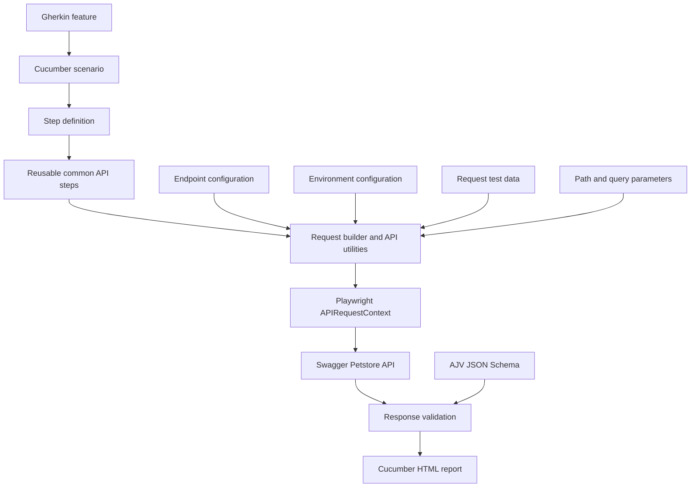
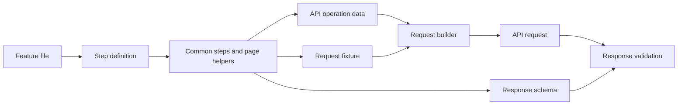

# 🧪 API Automation Portfolio

A maintainable **REST API test automation framework** built with **Playwright APIRequestContext, JavaScript, Cucumber BDD, and AJV JSON Schema validation**. The project uses the [Swagger Petstore API](https://petstore.swagger.io/) to demonstrate API test design, reusable automation components, data-driven scenarios, and pull-request quality checks with GitHub Actions.

The portfolio covers the automation lifecycle: designing scenarios, preparing requests, validating responses, investigating failures, and running repeatable checks in CI.

---

## 📚 Contents

- [Project overview](#-project-overview)
- [API under test and coverage](#-api-under-test-and-coverage)
- [Technology stack](#-technology-stack)
- [Framework workflow](#-framework-workflow)
- [Project structure](#-project-structure)
- [File mapping and naming convention](#-file-mapping-and-naming-convention)
- [Test data management](#-test-data-management)
- [Test execution](#-test-execution)
- [Validation strategy](#-validation-strategy)
- [GitHub Actions checks](#-github-actions-checks)
- [Reports](#-reports)
- [Implementation checklist](#-implementation-checklist)
- [QA automation value](#-qa-automation-value)

---

## 🎯 Project overview

The goal is to build a reusable API automation framework in which **test scenarios, step definitions, endpoint configuration, request data, and response schemas are separated**. This separation makes the suite easier to read, extend, debug, and maintain as additional API resources and operations are added.

### Key capabilities

- REST API testing with Playwright `APIRequestContext`.
- BDD scenarios written in Gherkin and executed by Cucumber-JS.
- Positive, negative, data-driven, and request-to-request integration testing.
- Reusable common steps and shared request/response utilities.
- Centralised endpoint configuration and environment settings.
- HTTP status, header, payload, and AJV schema validation.
- Cucumber HTML reporting and pull-request checks through GitHub Actions.

## 🌐 API under test and coverage

**System under test:** [Swagger Petstore](https://petstore.swagger.io/)  
**Base URL:** `https://petstore.swagger.io/v2`

| Method | Endpoint | Current testing focus |
|---|---|---|
| `POST` | `/pet` | Create a pet; valid and invalid request data; request and response validation |
| `GET` | `/pet/{petId}` | Retrieve by ID; valid, invalid, missing, negative, and non-numeric IDs; POST-to-GET integration |
| `GET` | `/pet/findByStatus` | Query-parameter testing for pet status |

`PUT` and `DELETE` operations are planned; they are not part of the completed coverage listed above.

## 🧰 Technology stack

| Technology | Role in this project |
|---|---|
| JavaScript and Node.js | Automation language and runtime |
| npm | Dependency and script management |
| Playwright `APIRequestContext` | Sends HTTP requests and receives API responses |
| Cucumber-JS and Gherkin | BDD scenario definition and execution |
| AJV | Validates response bodies against JSON Schemas |
| JSON | Endpoint configuration, request fixtures, and schemas |
| ESLint and Prettier | Code-quality and formatting checks |
| Git and GitHub | Version control, branches, and pull requests |
| GitHub Actions | Runs automated pull-request checks |
| CodeQL | Static analysis for potential security issues in JavaScript |

---

## 🔄 Framework workflow

The following diagram shows how a scenario is executed by the framework, from the feature file to the API response and report.



The feature describes **what** to test. Step definitions connect Gherkin phrases to JavaScript code. Shared utilities prepare and send the request, while response validation checks the API result against expected values and schemas.

## 🗂️ Project structure

The repository contains the automation project in `playwright-javascript/`. Folders are grouped by responsibility so that scenarios, implementation code, test data, and configuration are not mixed together.

```text
API-automation-portfolio/
├── .github/
│   └── workflows/                   # GitHub Actions workflow definitions
│
└── playwright-javascript/
    ├── config/                      # Environment and Playwright configuration
    ├── features/
    │   └── pet/                     # Gherkin features grouped by API resource
    ├── step-definitions/
    │   ├── common/                  # Reusable Cucumber steps
    │   └── pet/                     # Pet-specific step definitions
    ├── page-objects/
    │   ├── data/
    │   │   └── pet/                 # API operation data and response schemas
    │   └── pages/
    │       └── pet/                 # Pet-specific validation/helper logic
    ├── test-data/
    │   └── pet/                     # Request fixtures and named data variations
    ├── helpers/                     # Shared helpers, including API client/report helpers
    ├── support/
    │   ├── env/                     # Environment setup
    │   ├── utils/                   # Request, response, data, schema, and report utilities
    │   ├── hook.js                  # Cucumber hooks
    │   └── world.js                 # Scenario-level context
    ├── reports/                     # Generated reports (when present)
    ├── cucumber.js                  # Cucumber configuration
    ├── playwright.config.js         # Playwright configuration
    ├── run-tests.js                 # Test runner and tag handling
    ├── generateReport.js            # HTML report generation
    ├── package.json                 # Dependencies and npm scripts
    └── package-lock.json            # Locked dependency versions
```

### Why this structure?

| Location | Responsibility |
|---|---|
| `features/` | Readable scenarios grouped by resource and operation |
| `step-definitions/` | Gherkin-to-JavaScript implementation; common and resource-specific steps are separated |
| `page-objects/data/` | API operation configuration and response schemas |
| `page-objects/pages/` | Resource-specific helper and validation logic |
| `test-data/` | External request fixtures and named test-data variations |
| `helpers/` and `support/utils/` | Shared technical functions to reduce duplicated code |
| `support/world.js` | Scenario context, including request/response state and created-pet details |
| `.github/workflows/` | CI workflow definitions for pull-request checks |

## 🧭 File mapping and naming convention

Use the same resource and operation name across related files. This makes it easier for a developer or tester to navigate from a scenario to its step implementation and supporting data.

### Example: GET pet by ID

| Item | Example path | Purpose |
|---|---|---|
| Feature | `features/pet/pet-get-petId.feature` | Defines the scenarios and examples |
| Step definition | `step-definitions/pet/pet-get-petId.steps.js` | Implements the steps used by the feature |
| API operation data | `page-objects/data/pet/pet-get-petId-test-data.json` | Supplies endpoint/request configuration used by the request builder |
| Response schema | `page-objects/data/pet/pet-get-petId-api-schema.json` | Defines the expected response structure and types |
| Request fixture | `test-data/pet/pet-test-data.json` or the relevant resource fixture | Supplies named test values used by the scenario |

### How the files relate



### Naming pattern for a new operation

Replace `<resource>` and `<operation>` with the resource and action name:

```text
features/<resource>/<resource>-<operation>.feature
step-definitions/<resource>/<resource>-<operation>.steps.js
page-objects/data/<resource>/<resource>-<operation>-test-data.json
page-objects/data/<resource>/<resource>-<operation>-api-schema.json
```

For example, a future update-pet operation could use:

```text
features/pet/pet-put-pet.feature
step-definitions/pet/pet-put-pet.steps.js
page-objects/data/pet/pet-put-pet-test-data.json
page-objects/data/pet/pet-put-pet-api-schema.json
```

These are suggested names for future files, not a claim that the PUT operation is already implemented.

### Adding a new operation

1. Create the feature under `features/<resource>/` and add scenarios with meaningful Cucumber tags.
2. Add the matching resource step-definition file under `step-definitions/<resource>/`, reusing existing common steps where possible.
3. Add the API operation data under `page-objects/data/<resource>/` with the endpoint key, path, HTTP method, and API version expected by the framework.
4. Add request fixtures under `test-data/<resource>/` and use descriptive keywords in the scenario.
5. Add the response schema under `page-objects/data/<resource>/` and reference it through the existing schema-resolution mechanism.
6. Run the new scenario tag, then run lint, formatting checks, and the full test suite.

> **Cucumber matching note:** Cucumber does not pair feature and step-definition files by filename. The configured `--require "step-definitions/**/*.js"` pattern loads the step definitions, and Cucumber matches each Gherkin step to a registered expression. Matching filenames are a project naming convention that makes files easier for people to find and maintain.

Use `Id` consistently in filenames and identifiers (for example, `petId`). On Windows, case-only filename changes may require a two-step `git mv` rename so Git records the change.

## 🧪 Test data management

The framework separates two main data concerns:

1. **API operation data** in `page-objects/data/<resource>/`: identifies the endpoint configuration used by the request builder, such as endpoint key, path, method, and API version.
2. **Request fixtures** in `test-data/<resource>/`: provides named payload variations such as `valid pet`, `pending pet`, `sold pet`, `missing id pet`, `missing name pet`, `invalid status pet`, and `invalid type pet`.

Response schemas are stored separately using the `*-api-schema.json` naming convention.

For a POST-to-GET integration scenario, the POST response is saved in the Cucumber World. The created pet ID and details are then available to the following GET step, so the GET validation compares the retrieved pet with the pet created in that scenario.

## ▶️ Test execution

Run commands from the `playwright-javascript/` directory.

### Install dependencies

For a clean installation based on the committed lockfile:

```bash
npm ci
```

Use `npm install` when intentionally adding/updating dependencies or generating the lockfile. Commit `package.json` and `package-lock.json` together when dependency definitions change.

### Run tests

```bash
# Run the complete test suite
npm test

# Run GET pet by ID scenarios
node run-tests.js --tags "@GetPetById"

# Run POST pet scenarios
node run-tests.js --tags "@PostPet"

# Run scenarios tagged for regression
node run-tests.js --tags "@Regression"
```

Tags must exist in the feature files. Use the tag assigned to the scenario or feature you want to execute.

### Run quality checks

```bash
npm run lint
npm run format:check
```

To apply automatic fixes, use the scripts if they are defined in `package.json`:

```bash
npm run format:write
npm run lint:fix
```

Otherwise, run the tools directly:

```bash
npx prettier --write .
npx eslint . --ext .js --fix
```

### Recommended pre-push sequence

```bash
npm ci
npm run lint
npm run format:check
npm test
```

## 🔍 Validation strategy

| Validation layer | What is checked |
|---|---|
| HTTP response | Expected status code, content type, and relevant headers |
| Response payload | Expected values, required fields, data types, nested objects, and arrays |
| JSON Schema | AJV validates response structure and data types against the selected schema |
| Integration flow | Values saved from POST, such as the created pet ID, are reused and checked by GET |
| Negative behaviour | API responses for missing, invalid, non-existing, negative, and non-numeric input values |

The test data includes negative POST examples such as missing identifiers or names, invalid status values, and invalid data types. GET-by-ID tests also cover invalid and non-existing identifiers.

## ⚙️ GitHub Actions checks

GitHub Actions runs checks on pull requests so changes are reviewed by automated quality gates before merge. The latest shared pull-request result showed **5 of 5 checks passing**.

| Pull-request check | What it covers | Value to QA engineering |
|---|---|---|
| **Code Quality Checks – ESLint and Prettier** | Linting and formatting validation | Keeps automation code consistent and easier to maintain |
| **CodeQL Security Analysis – Analyze JavaScript** | Static analysis of JavaScript for potential security issues | Adds security analysis to the code review workflow |
| **Code scanning results – CodeQL** | Publishes the analysis results and alerts; the shared run reported no new alerts in changed code | Makes security findings visible during review |
| **Dependency Review** | Reviews dependency changes in the pull request | Helps identify dependencies with known vulnerabilities |
| **Playwright API Automation – Run API Automation Tests** | Executes the API automation suite | Helps detect functional regressions before merge |

### Recorded outcome

- **5/5 GitHub Actions checks passed** in the shared pull-request result.
- Code scanning reported no new alerts in the changed code.
- GitHub reported no conflicts with the base branch.
- A separate full local test execution reported **18 scenarios and 176 steps passed**. This local result is separate from the five CI checks.

## 📈 Reports

The framework generates a Cucumber HTML report under `reports/` after execution. It provides scenario outcomes and execution details. Further improvements may include retaining or publishing reports from CI runs and making regression history easier to review.

## ✅ Implementation checklist

### Completed

- [x] Playwright `APIRequestContext` setup
- [x] JavaScript and Node.js project setup
- [x] Cucumber-JS and Gherkin BDD integration
- [x] Feature files organised by API resource
- [x] Resource-specific step definitions and reusable common steps
- [x] Centralised API endpoint configuration
- [x] External JSON request/test data
- [x] Environment configuration support
- [x] Positive and negative API testing
- [x] POST Pet automation
- [x] GET Pet by ID automation
- [x] GET Pet by status automation
- [x] POST-to-GET integration using the created pet ID and response details
- [x] HTTP status, response-header, and payload validation
- [x] AJV JSON Schema validation
- [x] ESLint and Prettier checks
- [x] GitHub Actions pull-request checks for code quality, CodeQL, dependency review, and API automation
- [x] Cucumber HTML report generation

### Planned

- [ ] Complete Pet CRUD coverage with `PUT` and `DELETE`
- [ ] Add more path-parameter and query-parameter edge cases
- [ ] Maintain an endpoint-to-test coverage matrix
- [ ] Add authentication and authorisation scenarios where supported by the API
- [ ] Improve CI report retention and publishing
- [ ] Add execution against additional configured environments
- [ ] Document defect investigations with expected-versus-actual evidence
- [ ] Extend contract testing beyond the current response-schema checks
- [ ] Evaluate API performance testing as a separate test layer
- [ ] Evaluate Docker-based execution for consistent local and CI environments

## 💡 QA automation value

This project demonstrates practical experience in:

- **API testing:** REST testing, positive and negative scenarios, request/response checks, path and query parameters, schema validation, and multi-request integration flows.
- **Automation engineering:** Playwright APIRequestContext, JavaScript, Cucumber BDD, Scenario Outlines, external test data, reusable steps, and centralised endpoint configuration.
- **Quality engineering:** Regression testing, expected-versus-actual analysis, defect investigation, test reporting, and CI quality gates.
- **Engineering practices:** Git workflows, pull requests, GitHub Actions, linting, formatting, CodeQL analysis, and dependency review.

---

**Repository:** [Padmaqaauto / API-automation-portfolio](https://github.com/Padmaqaauto/API-automation-portfolio)  
**API documentation:** [Swagger Petstore](https://petstore.swagger.io/)
